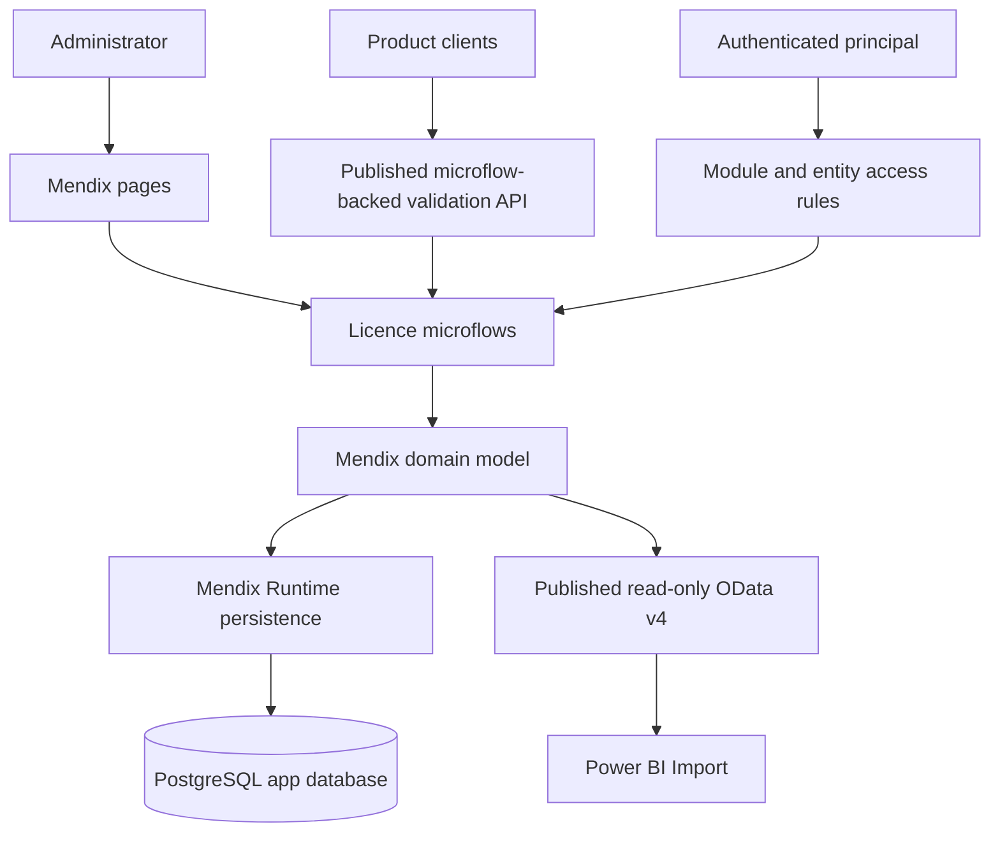
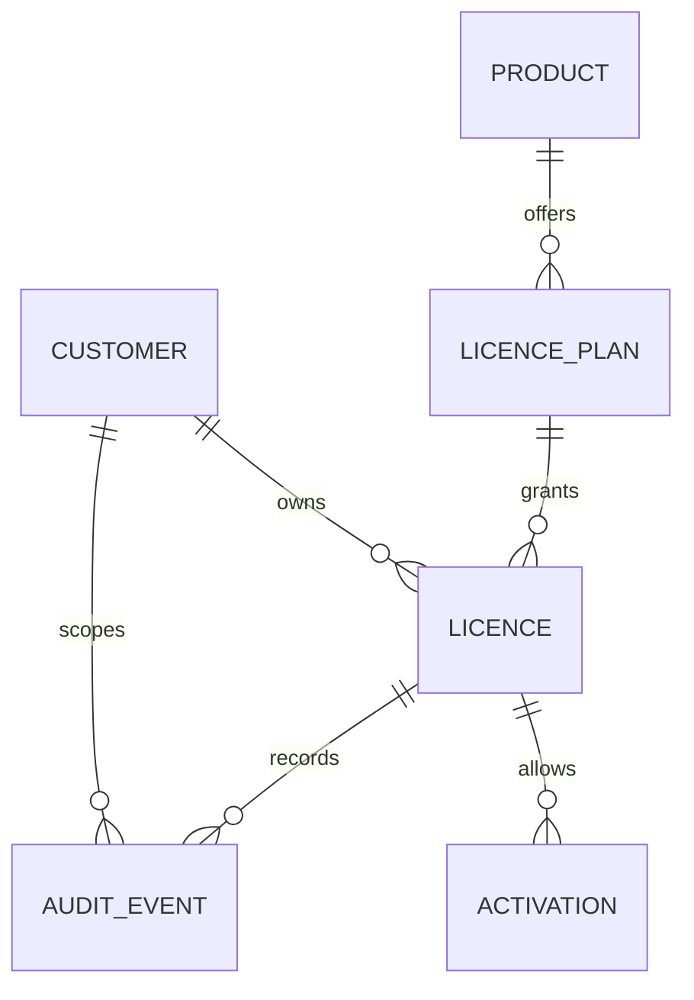

# Architecture Spine — LIC Licence Management

## Design Paradigm

Use one **Mendix model-driven application**. Organize domain entities, pages, microflows, and published services into cohesive modules. Mendix Runtime owns persistence of the domain model in PostgreSQL; do not treat generated tables as a public integration schema. This keeps licence policy in one application while leaving deployment as one independently operable Mendix app.

## Invariants & Rules

### AD-1 — One owner for licence policy

- **Binds:** LIC-LICENCE, LIC-ACTIVATION
- **Prevents:** Admin APIs and validation APIs applying different expiry, revocation, entitlement, or activation rules.
- **Rule:** All licence state transitions and effective-validity decisions MUST be implemented in licence microflows/domain logic. Pages, published services, and reports MUST NOT implement their own licensing policy.

### AD-2 — PostgreSQL is the transactional authority

- **Binds:** LIC-LICENCE, LIC-CUSTOMER, LIC-PRODUCT, LIC-ACTIVATION, LIC-AUDIT
- **Prevents:** Divergent licence state across caches, reports, and service instances.
- **Rule:** Licence mutations MUST go through Mendix Runtime and the Mendix domain model backed by PostgreSQL. Do not read/write Mendix-generated application tables outside the runtime. Any cache is disposable and MUST NOT authorize a licence without an explicitly defined freshness policy. Every successful state-changing command MUST persist its audit event as part of the same modeled operation.

### AD-3 — Licence secrets are one-way stored

- **Binds:** LIC-LICENCE, LIC-ACTIVATION
- **Prevents:** Database or reporting access exposing reusable licence keys or raw device identifiers.
- **Rule:** Generate high-entropy licence keys with a cryptographically secure generator; return the plaintext only once; persist a keyed HMAC digest and a non-secret display prefix. Persist device fingerprints as keyed digests. Keep pepper material in deployment secrets, never in Mendix constants stored with the app model. Secrets, credentials, and raw PII MUST NOT enter logs, audit metadata, or published BI entities.

### AD-4 — Expiration is derived from a single interval

- **Binds:** LIC-LICENCE, LIC-ACTIVATION
- **Prevents:** A stale persisted `expired` flag disagreeing with validity timestamps.
- **Rule:** A licence is time-valid exactly when `now_utc >= valid_from` and (`valid_until` is null or `now_utc < valid_until`). Persist lifecycle state only for administrative transitions (`active`, `suspended`, `revoked`); derive `pending` and `expired` from lifecycle state and timestamps.

### AD-5 — Activation limits are concurrency-safe

- **Binds:** LIC-ACTIVATION
- **Prevents:** Concurrent activation requests exceeding a licence's seat/device limit.
- **Rule:** When a hard activation cap is in scope, each activation MUST claim exactly one modeled `ActivationSlot` linked to the licence and slot claim MUST commit atomically with the activation history. A unique token alone is not sufficient. Before release, prove under concurrent requests that Mendix Runtime prevents two active activations claiming the same slot, with conflict detection and bounded retry. Do not lock or mutate Mendix-owned tables directly. If the proof fails, move slot claiming to a separately owned atomic service/store before shipping the hard cap.

### AD-6 — Reporting cannot mutate operational data

- **Binds:** LIC-REPORTING
- **Prevents:** Power BI refreshes or analyst queries changing licence state or degrading write availability.
- **Rule:** Power BI MUST consume a versioned, read-only Mendix OData v4 reporting service built from read-only View Entities with explicit View Entity access rules. Do not connect Power BI to Mendix-generated PostgreSQL tables. The default mode is Import with scheduled refresh; choose a separately owned reporting store fed through a supported Mendix API/export only if measured analytics needs justify it.

### AD-7 — Mendix module boundaries remain explicit

- **Binds:** all
- **Prevents:** UI, published-service, reporting, and custom Java concerns duplicating or bypassing domain behavior.
- **Rule:** Admin pages and published command/validation endpoints MUST call the shared licence microflows for policy decisions. BI OData endpoints are read-only projections and MUST NOT mutate domain entities. Module and view-entity access rules are explicit per role. Custom Java actions are isolated behind module interfaces and MUST NOT perform direct SQL against Mendix-owned tables.

### AD-8 — Customer data is scoped to the authenticated principal

- **Binds:** LIC-CUSTOMER, LIC-LICENCE, LIC-ACTIVATION, LIC-REPORTING
- **Prevents:** A customer-scoped user or client reading or mutating another customer's licence by changing a request parameter or identifier.
- **Rule:** Every customer-scoped read and write MUST derive allowed customer scope from the authenticated `(issuer, subject)` principal and enforce it through Mendix entity access rules and microflow validation. A request-supplied customer ID is never sufficient authorization. Cross-customer access is limited to explicitly privileged platform-administrator or internal-reporting roles; the same scope rule applies to published validation/reporting services.



## Consistency Conventions

| Concern | Convention |
| --- | --- |
| Identifiers | Mendix owns internal object IDs; expose immutable UUID-text `ExternalId` attributes. A licence key is a separate high-entropy secret. |
| Time | Store Mendix DateTime values in UTC; validity is a half-open interval `[ValidFrom, ValidUntil)`. |
| Mutation | State changes run through domain microflows; operations that clients may retry use a persisted idempotency key. |
| Service errors | Publish stable error codes, a safe message, and a correlation ID; validation must not disclose unrelated customer data. |
| Audit | Append-only domain events; include actor, action, target, timestamp, and correlation ID; redact secrets and PII. |
| Reporting | Versioned, read-only Mendix OData v4 projections with entity access rules; Power BI never reads the Mendix app database directly. |
| Data model changes | Evolve persistent entities through Mendix Studio Pro/runtime deployment; do not manage generated tables with independent SQL migrations. |

## Stack

| Name | Version |
| --- | --- |
| Mendix Studio Pro | 11.12 LTS (recommended current LTS; verified 2026-11-09) |
| PostgreSQL | 18.x (Mendix-supported major; verify exact patch/runtime compatibility with the hosting target) |
| Power BI OData Feed connector | Current Microsoft connector; OData Feed is supported for semantic models |

## Structural Seed

```text
Mendix app
  LicenceAdmin/      # administrator pages and licensed-user overview
  LicenceDomain/     # persistent entities, enums, validation and lifecycle microflows
  LicenceAPI/        # versioned OData v4 / REST published services
  LicenceReporting/  # read-only BI projection entities and published OData service
  Security/          # module roles, entity access rules, service access rules
  Operations/        # scheduled flows, audit/retention flows, health/monitoring hooks
```



## Capability → Architecture Map

| Capability / Area | Lives in | Governed by |
| --- | --- | --- |
| Issue, renew, suspend, revoke licence | `LicenceDomain` microflows | AD-1, AD-2, AD-3, AD-4 |
| Validate key and entitlement | versioned published service + `LicenceDomain` microflows | AD-1, AD-3, AD-4 |
| Activate/deactivate device | `LicenceDomain` microflows and entities | AD-1, AD-2, AD-5 |
| Customer/product administration | `LicenceAdmin` pages + `LicenceDomain` microflows | AD-1, AD-2, AD-7 |
| Audit history | `LicenceDomain` audit entities, append-only access rules | AD-2, AD-3 |
| Power BI reporting | `LicenceReporting` projection entities via OData v4 | AD-6 |

## Deferred

- Identity provider, administrator authentication method, and role mapping — decide before exposing administrative APIs beyond trusted environments.
- Offline licence validation and signed-token format — decide only if target products must operate without network access.
- Hosting target (Mendix Cloud vs private/on-premises), PostgreSQL provisioning, network topology, secrets management, backup strategy, RPO/RTO, and availability SLO — decide before production deployment.
- High-volume event streaming, separate analytics warehouse, or service decomposition — revisit when measured reporting or write workloads affect operational service objectives.
- Multi-region writes and tenant-specific encryption — revisit when residency, contractual, or regulatory requirements establish the need.
- Detailed entitlement taxonomy, licensing terms, customer ownership model, and device transfer policy — confirm with product/business owners before implementation.

## Assumptions and Open Questions

- **[ASSUMPTION]** Greenfield module; the repository contained no application source or project requirements documents at design time.
- **[ASSUMPTION]** Use Mendix 11.12 LTS and Mendix-managed PostgreSQL persistence; a non-Mendix-Cloud target must confirm its exact PostgreSQL/runtime compatibility.
- **[ASSUMPTION]** Each licence is granted to one customer organization for one product plan; plans are versioned and treated as immutable after assignment.
- **[ASSUMPTION]** Validation is online; device activation is supported but offline validation is not in the initial design.
- **[ASSUMPTION]** Power BI reads a minimized, read-only OData v4 projection rather than connecting to the application's PostgreSQL database.
- **[OPEN]** Confirm whether customers need per-user, per-device, floating/concurrent, or organization-wide licences.
- **[OPEN]** Confirm hosting, identity provider, expected scale, service objectives, data-residency and retention obligations.

## Technology verification sources

- [Mendix LTS/MTS releases](https://docs.mendix.com/releasenotes/studio-pro/lts-mts/)
- [Mendix data storage](https://docs.mendix.com/refguide/data-storage/)
- [Mendix system requirements and supported PostgreSQL versions](https://docs.mendix.com/refguide/system-requirements/)
- [Mendix published OData services](https://docs.mendix.com/refguide/published-odata-services/)
- [Expose Mendix data to BI tools using OData](https://docs.mendix.com/refguide/exposing-data-to-bi-tools-using-odata/)
- [Microsoft Power Query OData Feed connector](https://learn.microsoft.com/power-bi/desktop-connect-odata)
