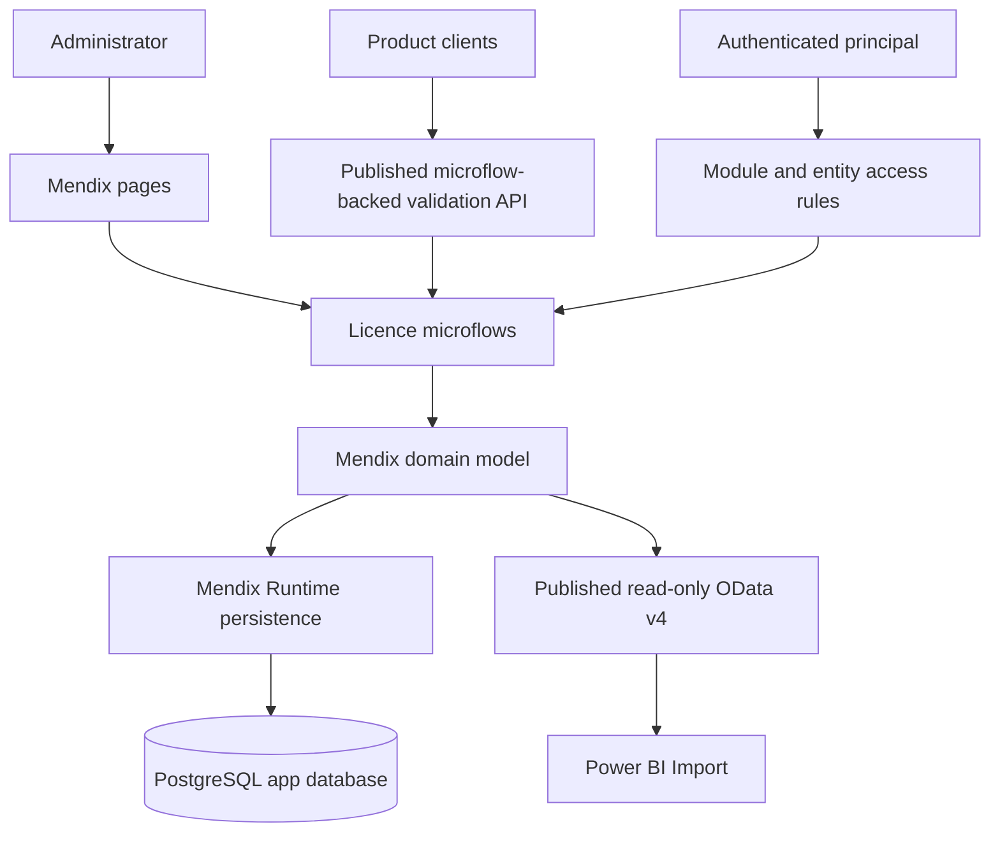
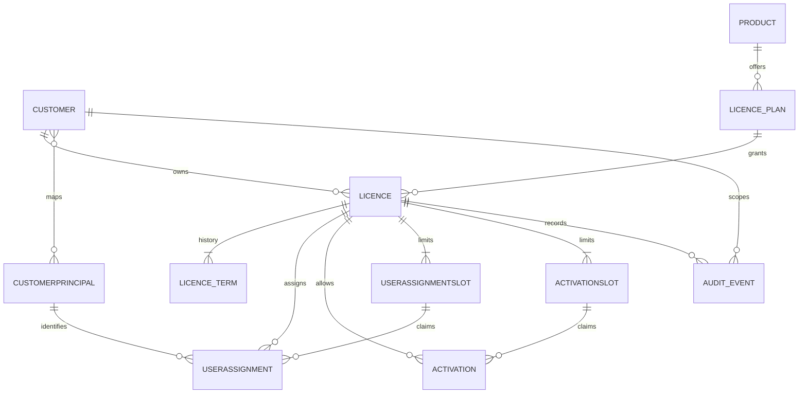

# Architecture Spine — LIC Licence Management

## Design Paradigm

Extend the existing **Mendix model-driven application** at `APP/LIC.mpr` (Mendix 11.11.0). The current model is a scaffold: mxcli reports nine modules, with `MyFirstModule` as the only app-owned module and currently containing `Home_Web` and `MyFirstLogic` but no domain entities; the other modules are Marketplace modules or `System`. Keep the existing scaffold and add cohesive licence modules within the same application. Mendix Runtime owns persistence of the domain model in PostgreSQL; do not treat generated tables as a public integration schema. This keeps licence policy in one application while leaving deployment as one independently operable Mendix app.

## Invariants & Rules

### AD-1 — One owner for licence policy

- **Binds:** LIC-LICENCE, LIC-LICENCE-TERM, LIC-USER-ASSIGNMENT, LIC-ACTIVATION
- **Prevents:** Admin APIs and validation APIs applying different expiry, revocation, entitlement, or activation rules.
- **Rule:** All licence state transitions and effective-validity decisions MUST be implemented in licence microflows/domain logic. Pages, published services, and reports MUST NOT implement their own licensing policy.

### AD-2 — PostgreSQL is the transactional authority

- **Binds:** LIC-LICENCE, LIC-LICENCE-PLAN, LIC-LICENCE-TERM, LIC-CUSTOMER, LIC-PRODUCT, LIC-USER-ASSIGNMENT, LIC-ACTIVATION, LIC-AUDIT
- **Prevents:** Divergent licence state across caches, reports, and service instances.
- **Rule:** Licence mutations MUST go through Mendix Runtime and the Mendix domain model backed by PostgreSQL. Do not read/write Mendix-generated application tables outside the runtime. Any cache is disposable and MUST NOT authorize a licence without an explicitly defined freshness policy. Every successful state-changing command MUST persist its audit event as part of the same modeled operation.

### AD-3 — Licence secrets are one-way stored

- **Binds:** LIC-LICENCE, LIC-USER-ASSIGNMENT, LIC-ACTIVATION
- **Prevents:** Database or reporting access exposing reusable licence keys or raw device identifiers.
- **Rule:** Generate high-entropy licence keys with a cryptographically secure generator; return the plaintext only once; persist a keyed HMAC digest and a non-secret display prefix. Persist device fingerprints as keyed digests. Keep pepper material in deployment secrets, never in Mendix constants stored with the app model. Secrets, credentials, and raw PII MUST NOT enter logs, audit metadata, or published BI entities.

### AD-4 — Validity is derived from immutable licence terms

- **Binds:** LIC-LICENCE, LIC-LICENCE-TERM, LIC-ACTIVATION
- **Prevents:** Renewals erasing prior validity periods or a stale persisted `expired` flag disagreeing with time rules.
- **Rule:** Issue and renewal create immutable `LicenceTerm` records. A licence is time-valid exactly when UTC now falls in at least one term's half-open interval `[ValidFrom, ValidUntil)`; an empty end is allowed only for Perpetual, while `Time-limited` and `Trial` terms require an end. A gap between terms is invalid. Trial terms are not renewable. Persist lifecycle state only for administrative transitions (`Active`, `Suspended`, `Revoked`); derive effective validity from lifecycle state and term timestamps.

### AD-5 — User and device limits are independent and concurrency-safe

- **Binds:** LIC-USER-ASSIGNMENT, LIC-ACTIVATION
- **Prevents:** A device being counted as a user, one user being double-counted, or concurrent claims exceeding either configured cap.
- **Rule:** Count active distinct user assignments against `MaxUsers` and active device activations against `MaxDevices` independently; a device activation has no required association to a user assignment. Each user claim occupies one `UserAssignmentSlot`; each device claim occupies one `ActivationSlot`; each slot claim MUST commit atomically with its assignment/activation history. A unique token alone is not sufficient. Before release, prove under concurrent requests that Mendix Runtime prevents two active claims occupying the same slot, with conflict detection and bounded retry. Do not lock or mutate Mendix-owned tables directly. If the proof fails, move the affected claim operation to a separately owned atomic service/store before shipping that hard cap.

### AD-6 — Reporting cannot mutate operational data

- **Binds:** LIC-REPORTING
- **Prevents:** Power BI refreshes or analyst queries changing licence state or degrading write availability.
- **Rule:** Power BI MUST consume a versioned, read-only Mendix OData v4 reporting service built from read-only View Entities with explicit View Entity access rules. Do not connect Power BI to Mendix-generated PostgreSQL tables. The default mode is Import with scheduled refresh; choose a separately owned reporting store fed through a supported Mendix API/export only if measured analytics needs justify it.

### AD-7 — Mendix module boundaries remain explicit

- **Binds:** all
- **Prevents:** UI, published-service, reporting, and custom Java concerns duplicating or bypassing domain behavior.
- **Rule:** Admin pages and published command/validation endpoints MUST call the shared licence microflows for policy decisions. BI OData endpoints are read-only projections and MUST NOT mutate domain entities. Module and view-entity access rules are explicit per role. Custom Java actions are isolated behind module interfaces and MUST NOT perform direct SQL against Mendix-owned tables.

### AD-8 — Customer data is scoped to the authenticated principal

- **Binds:** LIC-CUSTOMER, LIC-CUSTOMER-PRINCIPAL, LIC-LICENCE, LIC-USER-ASSIGNMENT, LIC-ACTIVATION, LIC-REPORTING
- **Prevents:** A customer-scoped user or client reading or mutating another customer's licence by changing a request parameter or identifier.
- **Rule:** Every customer-scoped read and write MUST derive allowed customer scope from the authenticated `(issuer, subject)` principal and enforce it through Mendix entity access rules and microflow validation. A request-supplied customer ID is never sufficient authorization. Cross-customer access is limited to explicitly privileged platform-administrator or internal-reporting roles; the same scope rule applies to published validation/reporting services.



## Consistency Conventions

| Concern | Convention |
| --- | --- |
| Identifiers | Mendix owns internal object IDs; expose immutable UUID-text `ExternalId` attributes. A licence key is a separate high-entropy secret. |
| Time | Store Mendix DateTime values in UTC; each immutable licence term uses the half-open interval `[ValidFrom, ValidUntil)`. |
| Mutation | State changes run through domain microflows; operations that clients may retry use a persisted idempotency key. |
| Service errors | Publish stable error codes, a safe message, and a correlation ID; validation must not disclose unrelated customer data. |
| Audit | Append-only domain events; include actor, action, target, timestamp, and correlation ID; redact secrets and PII. |
| Reporting | Versioned, read-only Mendix OData v4 projections with entity access rules; Power BI never reads the Mendix app database directly. |
| Data model changes | Evolve persistent entities through Mendix Studio Pro/runtime deployment; do not manage generated tables with independent SQL migrations. |

## Stack

| Name | Version |
| --- | --- |
| Mendix Studio Pro | 11.11.0 (selected by user; matches current app model) |
| PostgreSQL | 14–18 are listed as supported by Mendix documentation; select and verify the exact version for the private hosting/runtime target |
| Power BI OData Feed connector | Current Microsoft connector; OData Feed is supported for semantic models |

## Structural Seed

```text
Existing Mendix app: APP/LIC.mpr (Mendix 11.11.0)
  Existing modules: Administration, Atlas_Core, Atlas_Web_Content, DataWidgets,
                    FeedbackModule, MyFirstModule, NanoflowCommons, System, WebActions
  MyFirstModule: Home_Web page + MyFirstLogic microflow; no domain entities
  Add within this app:
    LicenceDomain/     # persistent licence entities, enums, validation and lifecycle microflows
    LicenceAdmin/      # internal and customer-facing pages
    LicenceAPI/        # versioned microflow-backed validation service
    LicenceReporting/  # read-only BI View Entities and published OData service
    Security/          # role, entity and service access rules (may be grouped with domain modules)
    Operations/        # scheduled flows, audit/retention and health/monitoring hooks
```



## Capability → Architecture Map

| Capability / Area | Lives in | Governed by |
| --- | --- | --- |
| Issue, renew, suspend, revoke licence | `LicenceDomain` microflows | AD-1, AD-2, AD-3, AD-4 |
| Validate key and entitlement | versioned published service + `LicenceDomain` microflows | AD-1, AD-3, AD-4 |
| Assign/remove customer users | `LicenceDomain` assignment entities and microflows | AD-1, AD-2, AD-5, AD-8 |
| Activate/deactivate device | `LicenceDomain` microflows and entities | AD-1, AD-2, AD-5 |
| Customer/product administration | `LicenceAdmin` pages + `LicenceDomain` microflows | AD-1, AD-2, AD-7 |
| Audit history | `LicenceDomain` audit entities, append-only access rules | AD-2, AD-3 |
| Power BI reporting | `LicenceReporting` projection entities via OData v4 | AD-6 |

## Deferred

- Identity provider, administrator authentication method, and role mapping — choose during integration before exposing administrative APIs beyond trusted environments.
- Offline licence validation and signed-token format — decide only if target products must operate without network access.
- Localhost/private infrastructure is the stated environment. Clarify whether localhost is development-only and define private production topology, PostgreSQL provisioning, network controls, secrets management, backup strategy, RPO/RTO, and availability SLO before production deployment.
- High-volume event streaming, separate analytics warehouse, or service decomposition — revisit when measured reporting or write workloads affect operational service objectives.
- Multi-region writes and tenant-specific encryption — revisit when residency, contractual, or regulatory requirements establish the need.
- Device deactivation/transfer policy and whether floating/concurrent user semantics are needed — confirm before implementing those lifecycle policies.

## Assumptions and Open Questions

- **[VERIFIED BASELINE]** `APP/LIC.mpr` exists at Mendix 11.11.0. mxcli reported nine modules; `MyFirstModule` has one page and one microflow and no domain entities. Treat this as an existing scaffold to extend, not a new app to create. Marketplace and System modules are dependencies, not targets for licence-domain changes.
- **[ADOPTED]** Keep Mendix Studio Pro 11.11.0, matching the current app model. Use Mendix-managed PostgreSQL persistence; confirm exact PostgreSQL/runtime compatibility for the selected private hosting target.
- **[ADOPTED]** Each licence is granted to one customer organization for one product plan; plans are versioned and treated as immutable after assignment. A plan version defines `LicenceType` (`Time-limited`, `Perpetual`, `Trial`), `MaxUsers`, and `MaxDevices` as separate terms.
- **[ADOPTED]** Licence validation is online in the initial release; offline validation is not included.
- **[ADOPTED]** Power BI reads a minimized, read-only OData v4 projection rather than connecting to the application's PostgreSQL database.
- **[ADOPTED]** User and device limits are independent. Count active distinct assigned principals against `MaxUsers`; count active device fingerprints against `MaxDevices`; do not require a user-device association.
- **[ADOPTED]** Renew active or expired `Time-limited` licences manually; the administrator enters the new period start/end, and the end must be after the start. `Trial` licences are not renewable; `Perpetual` licences require no renewal.
- **[OPEN]** Confirm identity provider, product-client authentication, exact private hosting topology, expected scale, service objectives, PostgreSQL version, data-residency and retention obligations.

## Technology verification sources

- [Mendix LTS/MTS releases](https://docs.mendix.com/releasenotes/studio-pro/lts-mts/)
- [Mendix Studio Pro 11.11 release notes](https://docs.mendix.com/releasenotes/studio-pro/11.11/)
- [Mendix data storage](https://docs.mendix.com/refguide/data-storage/)
- [Mendix system requirements and supported PostgreSQL versions](https://docs.mendix.com/refguide/system-requirements/)
- [Mendix published OData services](https://docs.mendix.com/refguide/published-odata-services/)
- [Expose Mendix data to BI tools using OData](https://docs.mendix.com/refguide/exposing-data-to-bi-tools-using-odata/)
- [Microsoft Power Query OData Feed connector](https://learn.microsoft.com/power-bi/desktop-connect-odata)
