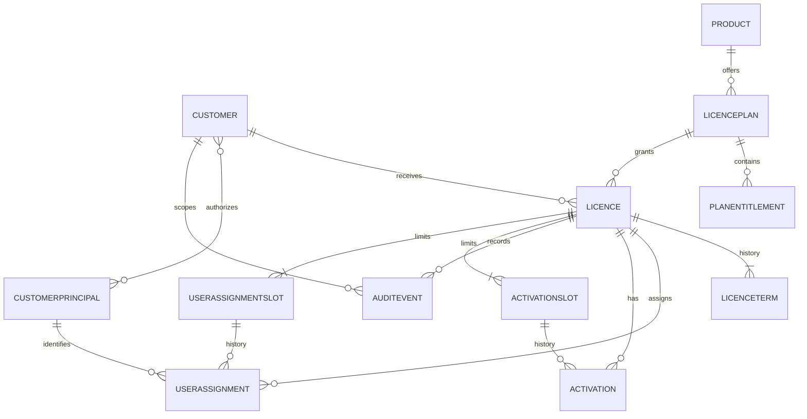

# Licence Management — Data Design for Mendix + PostgreSQL

**Status:** Final — aligned with approved requirements, architecture, and mxcli baseline  
**Companion to:** [ARCHITECTURE-SPINE.md](ARCHITECTURE-SPINE.md)  
**Persistence:** Mendix domain model persisted by Mendix Runtime in PostgreSQL  
**Date:** 2026-11-09

## 1. Persistence boundary

Mendix Runtime owns the physical PostgreSQL schema for persistent domain entities. Define entities, attributes, associations, validation, and access rules in Mendix Studio Pro. Do not create, rename, or update generated tables through direct SQL or treat them as a stable external integration contract.

For Mendix Cloud, Mendix provisions PostgreSQL persistence for the app. For private cloud or self-hosted deployment, confirm the exact PostgreSQL major/minor version against the selected Mendix Runtime and infrastructure. Each Mendix app must have its own database; cross-app/reporting access uses supported APIs or an explicitly separate reporting store.

This document is the **logical data model**, not a hand-authored DDL specification. Mendix internal object identifiers are runtime-managed and are not public API identifiers. Add opaque external IDs where consumers need stable references.

The existing Mendix 11.11.0 model is `APP/LIC.mpr`. mxcli reports nine modules; `MyFirstModule` currently contains one page and one microflow, with no domain entities. The other modules are Marketplace modules or `System`. This design adds licence entities to the existing application; it does not create a new MPR or modify Marketplace/System modules.

## 2. Logical entity relationship model

## 3. Domain entities

Recommended Mendix module: `LicenceDomain`. Mark records with lifecycle history as non-deletable through page, microflow, and entity access rules. Attribute names are conceptual; use Mendix types that map cleanly to PostgreSQL and published OData.

### `Customer`

| Attribute | Mendix type | Rules |
| --- | --- | --- |
| `ExternalId` | String (UUID text) | Required, unique, immutable after creation |
| `CustomerCode` | String | Required, unique |
| `Name` | String | Required |
| `ContactEmail` | String | Optional PII; do not publish to BI unless explicitly required |
| `LifecycleState` | Enumeration | `Active`, `Archived` |
| `CreatedAt`, `UpdatedAt` | DateTime | Required, UTC |

### `CustomerPrincipal`

Maps an authenticated external identity to one or more customer organizations. Resolve this mapping from the authenticated principal; never authorize a request based only on a client-supplied customer ID.

| Attribute | Mendix type | Rules |
| --- | --- | --- |
| `Issuer` | String | Required; normalized identity-provider issuer identifier |
| `ExternalPrincipalId` | String | Required; stable subject ID from that issuer, not email |
| `PrincipalKey` | String | Required, unique; deterministic canonical combination of `Issuer` and `ExternalPrincipalId` |
| `LifecycleState` | Enumeration | `Active`, `Disabled` |

Association: many-to-many between `CustomerPrincipal` and `Customer`, allowing a principal to act for one or more organizations. Platform administrators use a separate privileged module role. Resolve identity by the `(Issuer, ExternalPrincipalId)` pair so switching or adding an identity provider cannot collide subjects.

### `Product`

| Attribute | Mendix type | Rules |
| --- | --- | --- |
| `ExternalId` | String (UUID text) | Required, unique, immutable |
| `ProductCode` | String | Required, unique |
| `Name` | String | Required |
| `LifecycleState` | Enumeration | `Active`, `Archived` |
| `CreatedAt`, `UpdatedAt` | DateTime | Required, UTC |

### `LicencePlan`

An immutable version of a product's licensing terms. Create a new version when the plan changes; do not silently change terms for already-issued licences.

| Attribute | Mendix type | Rules |
| --- | --- | --- |
| `ExternalId` | String (UUID text) | Required, unique, immutable |
| `PlanCode` | String | Required |
| `Version` | Integer | Required, > 0 |
| `LicenceType` | Enumeration | Required; `Time-limited`, `Perpetual`, or `Trial` |
| `MaxUsers` | Integer | Required, > 0; independent user assignment cap |
| `MaxDevices` | Integer | Required, > 0; independent device activation cap |
| `LifecycleState` | Enumeration | `Draft`, `Active`, `Retired` |
| `CreatedAt`, `CreatedBy` | DateTime, String | Required |

Association: `LicencePlan_Product` is many plans to one product. `LicencePlan` owns the licence type and both limits; every licence references one immutable plan version. Enforce a unique `(Product, PlanCode, Version)` combination in domain logic and prevent edits to terms once the plan has issued licences. Mendix entity-level uniqueness may not cover a composite key; if concurrent plan creation must be guaranteed, validate a dedicated unique `PlanVersionKey` string. `MaxUsers` and `MaxDevices` are never combined into one activation count.

### `PlanEntitlement`

One entitlement for one plan. Keep a stable entitlement code and a typed value (for example string, integer, or boolean) rather than unvalidated JSON where possible.

| Attribute | Mendix type | Rules |
| --- | --- | --- |
| `EntitlementCode` | String | Required |
| `ValueText` | String | Optional, type-specific interpretation |
| `ValueInteger` | Integer | Optional |
| `ValueBoolean` | Boolean | Optional |

Association: many `PlanEntitlement` records to one `LicencePlan`. Domain validation ensures exactly one value field is set as required by the entitlement definition. Keep secrets out of entitlement values.

### `Licence`

One customer grant for one product plan. Do not persist a mutable `Expired` state; derive effective validity from lifecycle state and its immutable validity terms.

| Attribute | Mendix type | Rules |
| --- | --- | --- |
| `ExternalId` | String (UUID text) | Required, unique, immutable; public-safe reference |
| `KeyDigest` | String | Required, unique; keyed HMAC digest, never raw key |
| `KeyPrefix` | String | Required; non-secret lookup hint |
| `KeyVersion` | Integer | Required; digest/key-generation version |
| `LifecycleState` | Enumeration | `Active`, `Suspended`, `Revoked` |
| `IssuedAt`, `IssuedBy` | DateTime, String | Required |
| `RevokedAt`, `RevokedBy`, `RevocationReason` | DateTime, String, String | Required only when revoked; reason should not contain sensitive details |
| `CreatedAt`, `UpdatedAt` | DateTime | Required |

Associations: many `Licence` records to one `Customer`; many `Licence` records to one immutable `LicencePlan`; one licence has one or more `LicenceTerm` records. The licence type and configured `MaxUsers`/`MaxDevices` are read from its immutable plan version. Revocation fields must match `LifecycleState`.

Effective validity precedence: `Revoked`, then `Suspended`; otherwise the licence is time-valid if UTC now falls in any term interval `[ValidFrom, ValidUntil)`. A gap between terms is not valid. Before the first term it is pending; after the final term it is expired. An empty `ValidUntil` is allowed only for a Perpetual term. Retiring a plan or archiving a customer does not silently change an issued licence; use explicit suspension/revocation actions.

Generate licence secrets with a cryptographically secure random source and return the plaintext only once. Store only an HMAC digest in `KeyDigest`; keep the pepper in deployment secret storage, not in source control or ordinary Mendix constants. Rotation may require re-issuing keys because raw values are not recoverable. Never publish the digest or raw key through OData.

### `LicenceTerm`

An immutable validity period for a licence. Create the first term at issue and a new term for each permitted renewal; never overwrite earlier terms. This preserves validity-period history.

| Attribute | Mendix type | Rules |
| --- | --- | --- |
| `ExternalId` | String (UUID text) | Required, unique |
| `TermNumber` | Integer | Required, > 0; unique within the licence |
| `ValidFrom` | DateTime | Required, UTC; entered for a renewal |
| `ValidUntil` | DateTime | Optional, UTC; exclusive upper bound |
| `RecordedAt`, `RecordedBy` | DateTime, String | Required; renewal actor and time |

Association: many `LicenceTerm` records to one `Licence`. Require `ValidUntil > ValidFrom` when an end exists. Initial issue creates one term. Manual renewal can add a term only to an Active or Expired `Time-limited` licence; the administrator enters its start and end. `Trial` is not renewable and `Perpetual` does not need renewal. A term with no end is valid only for Perpetual type. Every term change is audited.

Validation permits use only when the licence lifecycle state permits it and the current time is within at least one recorded term. If terms have a gap, the licence is invalid during that gap; the validation service returns a safe invalid reason.

### `UserAssignment`

Historical assignment of one customer principal to a licence. User assignments are counted separately from device activations.

| Attribute | Mendix type | Rules |
| --- | --- | --- |
| `ExternalId` | String (UUID text) | Required, unique |
| `AssignedAt` | DateTime | Required, UTC |
| `AssignedBy` | String | Required actor reference |
| `RemovedAt` | DateTime | Empty means active |
| `RemovedBy` | String | Required when removed |
| `ActiveAssignmentKey` | String | Unique while active; deterministic licence/principal key, cleared on removal |

Associations: each assignment references one `Licence`, one `CustomerPrincipal`, and one `UserAssignmentSlot`. The principal must be actively mapped to the same customer organization as the licence. A duplicate active assignment for the same `(Licence, CustomerPrincipal)` is idempotent and consumes no additional user slot. Count active distinct customer principals against the plan's `MaxUsers`; removal releases the slot and preserves the assignment record.

### `UserAssignmentSlot`

Modeled slot capacity for the licence's `MaxUsers` hard cap. Create the plan-defined number of slots for each issued licence. Each slot has no more than one active assignment at a time and can be reused after removal; historical assignments remain linked to it.

| Attribute | Mendix type | Rules |
| --- | --- | --- |
| `SlotNumber` | Integer | Required; unique within the licence |
| `SlotToken` | String | Required, unique; identifies a slot but does not guarantee atomic occupancy |

Enforce single active occupancy through the assignment microflow and prove conflict detection/retry under concurrent claims on the selected Mendix Runtime before release. Do not mutate Mendix-owned tables directly.

### `Activation`

One historical device activation/deactivation record. Store a keyed digest of the device fingerprint, not raw hardware identifiers.

| Attribute | Mendix type | Rules |
| --- | --- | --- |
| `ExternalId` | String (UUID text) | Required, unique |
| `DeviceDigest` | String | Required; keyed digest |
| `DeviceLabel` | String | Optional; user-provided and potentially identifying |
| `ActivatedAt` | DateTime | Required |
| `DeactivatedAt` | DateTime | Empty means active |
| `LastValidatedAt` | DateTime | Optional |
| `ActiveDeviceKey` | String | Unique while active; deterministic licence/device-digest key, cleared on deactivation |

Associations: many `Activation` records to one `Licence`, and many historical `Activation` records to one `ActivationSlot`. A device activation has no required association to a user assignment. Exactly zero or one activation associated with a slot may have `DeactivatedAt` empty. Prevent duplicate active `(Licence, DeviceDigest)` claims in the activation microflow. Use `ActivationSlot` entities to represent the licence's independent `MaxDevices` cap; concurrent claims against the same slot must be tested on the chosen Mendix Runtime. If conflict/retry cannot guarantee the limit, use a separately owned activation service/store rather than unsupported direct SQL against Mendix tables.

### `ActivationSlot`

Modeled seat allocation for the licence's `MaxDevices` hard cap. Create the plan-defined number of slots for the issued licence; a slot has either no active activation or one active activation.

| Attribute | Mendix type | Rules |
| --- | --- | --- |
| `SlotNumber` | Integer | Required; unique within the licence, enforced by a composite token |
| `SlotToken` | String | Required, unique; generated from licence external ID plus slot number. Identifies a slot but does not by itself guarantee atomic occupancy. |

Association: many `ActivationSlot` entities to one `Licence`; each `Activation` references one slot. A slot is reused only after deactivation, preserving activation history. Enforce single active occupancy in the activation microflow and prove atomic conflict behavior before release.

### `AuditEvent`

Append-only history for significant business and security actions.

| Attribute | Mendix type | Rules |
| --- | --- | --- |
| `ExternalId` | String (UUID text) | Required, unique |
| `ActorType` | Enumeration | `Admin`, `Client`, `System` |
| `ActorId` | String | Optional external principal reference |
| `Action` | String or Enumeration | Required controlled action vocabulary |
| `TargetType`, `TargetExternalId` | String | Required |
| `OccurredAt` | DateTime | Required, UTC |
| `CorrelationId` | String | Optional UUID text |
| `SafeMetadata` | String/structured child entity | Allowlisted non-sensitive details only |

Associations: optional many events to one `Customer`, optional many events to one `Licence`. Restrict updates/deletes through module security; create events through the same microflow that performs the business command. Do not put keys, digests, credentials, contact details, or raw device identifiers in audit metadata.

## 4. Mendix security and operations

- Define app, module, and entity access rules for administrator, product-client, and reporting roles.
- Keep destructive delete unavailable for issued licences, terms, user assignments, plans with issued grants, activations, and audit events; use archive/revocation/deactivation transitions.
- Expose only explicit operations through published services. Do not enable CRUD wholesale on licence or audit entities.
- Use microflows for issue, renew, suspend, revoke, validate, assign/remove user, activate/deactivate device. Each flow validates authorization and business invariants before committing.
- Add an idempotency token to service operations that may be retried, and persist the request outcome so retries do not issue duplicate licences or activations.
- Monitor Mendix Runtime errors and service latency. Confirm database backup, restore, retention, RPO, and RTO with the selected deployment target.

## 5. Power BI integration

Publish a versioned, **read-only OData v4** service from a dedicated `LicenceReporting` module using Mendix View Entities over the domain model. View Entities are query-backed and read-only; enable OQL v2 and verify query performance with expected refresh volume. Mendix documents View Entities as publishable through OData and OData as a supported BI route. Configure app security, allowed module roles, and access rules directly on each View Entity: do not assume the source entities' access rules automatically protect a View Entity. Restrict the default Power BI principal to the internal reporting role; expose customer-scoped reporting only after proving row-level customer filtering works for that identity model.

Initial read-only View Entities:

- `LicenceSummary`: licence external ID, customer code/name, product/plan/version/type, issue date, validity dates, derived state, user/device limits and active counts, revocation timestamp.
- `LicenceActivityDaily`: date, product, plan, action category, aggregated event count.
- `UserAssignmentUtilization`: licence external ID, user limit, active assigned-principal count, utilization ratio.
- `ActivationUtilization`: licence external ID, device limit, active device count, utilization ratio.

Exclude `KeyDigest`, `KeyPrefix` where not needed, contact email, actor identity, device digest, raw audit metadata, and internal Mendix IDs. Start with Power BI Import and scheduled refresh; only enable write operations if there is a separate, explicitly reviewed use case. If analytics requires direct PostgreSQL/DirectQuery at higher volume, create a separately owned reporting database or warehouse populated through supported Mendix APIs/exports. Never point Power BI at the Mendix-generated app schema.

## 6. Logical integrity and indexes

Use Mendix entity uniqueness where available for `ExternalId`, product/customer codes, key digest, and slot tokens. For composite uniqueness such as plan version, term number, active user assignment per licence/principal, or active device per licence, use dedicated unique tokens or equivalent domain constraints and validate behavior under concurrent requests. Keep entity associations restrictive; archive rather than cascade-delete business history.

The physical indexes and foreign keys are generated/managed by Mendix Runtime. Do not add manual indexes directly to a Mendix-managed database unless the selected Mendix hosting/runtime explicitly supports and documents that operation. Review slow OData and microflow queries using Mendix-supported monitoring and optimization tools.

## 7. Open decisions before production

- Confirm the device deactivation/transfer policy and whether floating/concurrent user semantics are needed. User and device caps are already decided to be independent.
- Private infrastructure is the stated operating environment; clarify whether localhost is development-only and define the production topology. Mendix documentation currently lists PostgreSQL 14–18 as supported; verify the exact version against the selected Mendix Runtime and host.
- Prototype concurrent user-assignment-slot and activation-slot claims on the chosen Mendix Runtime; both are integrity gates for the hard caps.
- Confirm identity provider, published-service authentication, refresh credentials for Power BI, and tenant-level row visibility.
- Confirm data retention, audit retention, deletion/anonymization rules, availability, backup, RPO/RTO, and expected volume/refresh cadence.

## 8. References

- [Mendix data storage](https://docs.mendix.com/refguide/data-storage/)
- [Mendix system requirements](https://docs.mendix.com/refguide/system-requirements/)
- [Mendix Studio Pro 11.11 release notes](https://docs.mendix.com/releasenotes/studio-pro/11.11/)
- [Mendix OData services](https://docs.mendix.com/refguide/published-odata-services/)
- [Mendix: expose data to BI tools using OData](https://docs.mendix.com/refguide/exposing-data-to-bi-tools-using-odata/)
- [Mendix View Entities](https://docs.mendix.com/refguide/view-entities/)
- [Mendix: decoupling APIs with View Entities](https://docs.mendix.com/refguide/decoupling-apis/)
- [Microsoft Power Query OData Feed connector](https://learn.microsoft.com/power-bi/desktop-connect-odata)
